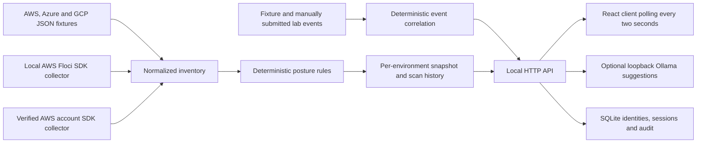

# Architecture

The application listens on IPv4 loopback and checks the request host. Browser mutations must use the same origin or an explicitly enabled loopback Vite proxy. The built React client and APIs share one origin. The collector only accepts an explicit HTTP loopback endpoint. AWS SDK v3 requests use dummy credentials, a fixed `us-east-1` region, an explicit endpoint and a collection deadline. The application collector only reads inventory and posture.

The connector boundary also supports named live sources. A configured AWS account is checked with STS before inventory requests. Each scan reports its provenance, connection, coverage, and timestamps. A partial snapshot retains older findings whose conditions could not be rechecked. Azure and GCP have independent disconnected adapters. See the [cloud configuration and credential guide](cloud-sources.md).

| Floci API scope | Normalized evidence |
| --- | --- |
| S3 `ListBuckets`, `GetBucketPolicyStatus`, `GetBucketEncryption` | Bucket names, reported public policy status and default encryption algorithms |
| IAM `ListUsers`, `ListAttachedUserPolicies`, `GetLoginProfile`, `ListMFADevices` | Users, directly attached policies, console login and modeled MFA devices |
| EC2 `DescribeSecurityGroups`, `DescribeInstances` | Group ingress with ports, protocols, and CIDRs, plus instance state, reported public IP and associated groups |

Documented operation support was checked against upstream and the project exercised Floci 2.5.0. [S3 operations](https://github.com/floci-io/floci/blob/2.5.0/docs/services/s3.md) · [IAM operations](https://github.com/floci-io/floci/blob/2.5.0/docs/services/iam.md) · [EC2 operations](https://github.com/floci-io/floci/blob/2.5.0/docs/services/ec2.md)

Startup, the periodic scheduler, and API requests share one scan queue. The queue coalesces requests for the same environment. Each attempt publishes one successful snapshot after normalization and assessment. Failed collection records its own status and error and preserves the inventory, findings, and last successful time. The dashboard reads one scoped snapshot per poll. An environment with no successful inventory has null counts. A successful empty inventory has zero counts.

Finding IDs hash provider, environment, resource type and ID, and rule ID. Repeated findings retain first-detected time and update last-seen time. If a finding disappears from a successful snapshot it resolves, then reopens under the same ID if it recurs. Per-environment timeline entries retain the most recent 30 attempts. Scan state, resolution history, and events are held in process memory.

The event engine groups events by provider, environment and actor over a 15-minute window ending at the latest event in each group. Incident summaries and observations are derived from stored events. Ollama receives a concise evidence set and may supply tentative hypotheses and verification steps; it cannot create recorded observations, change severities, or run actions.

## Authentication boundary

SQLite stores users, salted scrypt verifiers, hashed session tokens with absolute expiry, rate-limit buckets, short-lived OAuth flows, and audit records. Browser session cookies are HttpOnly and SameSite=Strict. The password and first OAuth request use a pre-authentication CSRF token. Authenticated requests use a CSRF token bound to the current session. Login rotates the token and logout revokes it in SQLite.

The server checks identity on every sensitive route. Viewers can read monitoring data. Admins can initiate scans, ingest or replay lab events, run investigations, and record simulated responses. The explicit CLI is the only provisioning path for an admin. Audit entries use the current authenticated identity. Password login is throttled by normalized account and client IP.

Google OIDC uses `openid-client` with Authorization Code and PKCE S256. A short-lived SameSite=Lax cookie ties the browser to a one-use server-side flow with state, verifier, and nonce. The callback validates the ID token signature and claims before issuing a local viewer session. Accounts are bound to Google’s subject identifier and email matches do not auto-link accounts. [OpenID client library](https://github.com/panva/openid-client) · [OWASP password storage guidance](https://cheatsheetseries.owasp.org/cheatsheets/Password_Storage_Cheat_Sheet.html)
