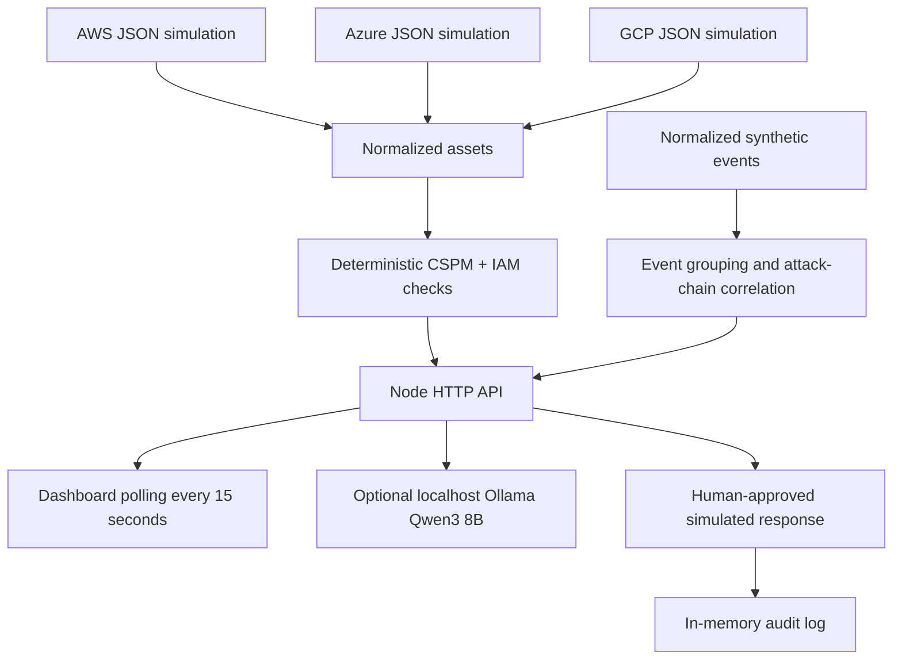

# Architecture and threat model

**Trust boundary:** The simulator produces data; no real cloud control plane is accessed. The web interface is only bound to `127.0.0.1`. Inputs are validated partially and should not be exposed to untrusted clients. The AI only receives incident evidence and is not authorized to execute actions. Actions never touch cloud infrastructure.

The asset adapter boundary normalizes `storage`, `firewall`, `identity`, and `compute` resources across provider-specific examples. The normalized model enables shared checks, but does not imply equivalence between AWS IAM policy evaluation, Azure RBAC, and Google Cloud IAM; the initial IAM rule is an intentionally simplified demonstration.

Rules are defined in `security-engine/engine.js`. Findings come from current asset fields, not pre-stored results. Event correlation groups by provider, environment and actor and examines activity in the most recent 15-minute window relative to the latest event in each group. This may miss longer attack sequences or cross-identity attack paths.
