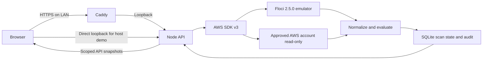

# CloudSentinel professor demo

**Demo claim** A real resource in the local AWS-compatible emulator is read with AWS SDK v3. A deterministic rule produces evidence. An independent complete scan verifies the effect of remediation under the same finding ID, and SQLite retains the lifecycle and audit records.



## Windows preflight

Run from the repository root. Review existing listeners and Docker containers before choosing which Floci instance to use. Reuse a verified, operator-approved Floci instance or start a disposable container once. The port must bind only to loopback. Preserve existing containers, databases, certificates and settings.

```powershell
docker ps -a --format '{{.Names}} {{.Status}} {{.Ports}}'
Get-NetTCPConnection -State Listen -LocalPort 3153,443,4566 -ErrorAction SilentlyContinue
# If 4566 is free and you chose a new isolated emulator:
docker run -d --name cloudsentinel-floci-v2 -p 127.0.0.1:4566:4566 floci/floci:2.5.0
# Or explicitly start the stopped, verified demo container you intend to reuse:
# docker start cloudsentinel-floci-v2
Invoke-RestMethod http://127.0.0.1:4566/_floci/info | Select-Object emulator,cloud,version
$env:FLOCI_ENDPOINT = 'http://127.0.0.1:4566'
$env:FLOCI_LAB_ENABLED = '1'
$env:AUTH_DB_PATH = 'data/professor-demo-v2.sqlite'
$env:SCAN_INTERVAL_MS = '600000'
$env:PORT = '3153'
npm ci
npm run build
npm run demo:preflight
# First use of this database only. Choose a strong password when prompted.
npm run setup:admin -- demo-admin@example.test
npm run demo:preflight
npm start
```

A runnable setup reports Floci **2.5.0**, a successful real **ListBuckets**, and at least one admin. An Ollama warning is acceptable for this demo. A missing database or admin is a preflight blocker before provisioning. For repeat runs, keep the same SQLite database and Floci container and choose a new prefix or let the Lab generate another unique name. Open `http://127.0.0.1:3153`.

For an authorized second device, run `./scripts/start-lan.ps1 -Plan` in the same configured shell. Follow the Private profile, scoped firewall and root-CA trust steps in the [LAN guide](lan-deployment.md). Start either the local Node process or the LAN launcher on 3153. Confirm HTTPS using `./scripts/test-lan.ps1` and then open the printed URL on the authorized device. Verify external access and browser trust separately.

## Presentation sequence, 11 minutes

| Time | Show and verify |
| --- | --- |
| 0:00–1:00 | Introduce the evidence chain above. Show the verified Floci version and source label EMULATOR. |
| 1:00–2:15 | Try a wrong password, then sign in as the demo admin. Select **Audit → Open operations → Security audit**. Show the attempt, outcome, UTC time and difference between password attempts, successful password logins and rate-limited attempts. Account searches can locate failed attempts without attributing them to an authenticated actor. |
| 2:15–3:45 | Open **Environments → Open operations → Floci S3 Lab**, or use `/workspace/floci-s3`. Create a **Secure private bucket** by entering and confirming a prefix. Check no policy and all four bucket-level blocks enabled. Choose **Create a demo bucket** and create a **Public-policy demo bucket** with a different prefix. Refresh and check public policy status and blocks off. Both resources must be empty and generated by the Lab. |
| 3:45–5:10 | Select **Run complete scan**. Read **S3-001**, its severity, stable finding ID, observed evidence and recommendation. The scan must report **Complete scan**. |
| 5:10–6:30 | Choose **Secure private bucket**, type the exact generated bucket name, and select **Remediate bucket**. Show actual before/after evidence and refresh. Run another complete scan. Confirm the original ID reads **RESOLVED** and review the resolution evidence. |
| 6:30–8:20 | In a second terminal using the same environment and database, run the public command below and confirm the exact name. Return to the browser, rescan, and show **REOPENED** in audit. Run the secure command, inspect, and rescan again. Confirm the same ID resolves and the terminal entries have no website actor. |
| 8:20–9:15 | Show the bucket and finding timelines. Open an audit detail and use its operation ID to find matching scan records. Export the filtered timeline as CSV. |
| 9:15–10:10 | Restart only the demo Node process with the same SQLite path, leaving Floci running. Reload the workspace and show the persisted session or sign in if expired. Verify the same finding ID and all four lifecycle events. |
| 10:10–11:00 | Show the optional critical SSH output or run the short demo below. Close by explaining the real AWS and EC2 verification boundaries. |

Five-minute fallback: show one failed login and the successful sign-in (45 seconds), create and detect the public demo bucket (90 seconds), remediate and verify the same ID (90 seconds), then show the audit timeline and explain actual AWS coverage (75 seconds). Rehearse terminal and restart steps in advance and show their recorded evidence if time is short.

## Terminal and critical SSH demonstrations

In the second terminal set the same `FLOCI_ENDPOINT`, `FLOCI_LAB_ENABLED` and `AUTH_DB_PATH` variables. Replace `BUCKET` with the generated ID. Confirm changes by typing that same ID when prompted.

```powershell
npm run lab:s3 -- list
npm run lab:s3 -- inspect BUCKET
npm run lab:s3 -- public BUCKET
# Run a complete scan in the website. Audit shows finding-reopened.
npm run lab:s3 -- secure BUCKET
npm run lab:s3 -- inspect BUCKET
# Run a complete scan in the website. Audit shows finding-resolved.
npm run lab:ssh
```

Type `DEMO SSH` for the optional CLI sequence. It creates one unique detached Floci group, observes an actual TCP 22 ingress finding (CSPM-004, CRITICAL), revokes that rule, and recollects inventory while the group still exists. Expect the serialized opening finding and resolution to share an ID. Cleanup removes only the temporary group. S3 lab buckets remain in the emulator and the final template should be secure.

## Evidence and safe recovery

- The S3 activity chain must read `finding-opened → finding-resolved → finding-reopened → finding-resolved` for one ID. When filtering by finding, scan records can be located by operation ID. Audit stores UTC, outcome, environment, resource ID and the actor only where authenticated.
- A failed or partial scan is an incomplete observation. Keep the prior open finding, check Floci health, wait for the active scan to finish and request another complete scan. An already-secure configuration can be inspected or reapplied to a managed bucket. A missing bucket calls for a fresh disposable bucket with a new audit trail.
- After an expired session, sign in again and refresh the Lab. Inspect the existing bucket before retrying an interrupted change. Do not register or repurpose a bucket created by one of the standalone SDK helpers. Use the guided Lab and terminal commands above.
- For archived audit evidence, select a bounded UTC date range. `From` is inclusive, `Before` is exclusive, and each CSV is limited to 10,000 entries. Store exports and backups privately.
- Google OAuth start, success and failure are covered by a mocked OIDC provider in tests. Show real OAuth evidence only after configuring a real client, an exact callback, and obtaining a successful sign-in on the approved origin.
- AWS SDK calls in this sequence target Floci, including the optional security group. The separate LIVE AWS path uses a scoped credential provider, verifies the account with STS, and reads S3, IAM users and roles, EC2 and security groups. Validated here using mocks. An authorized account and approved read-only scope are needed for live verification. [AWS coverage](cloud-sources.md)
- On EC2, use the existing systemd/Caddy profile and choose the isolated emulator or read-only cloud mode. Authenticate behind the approved boundary and retain SQLite on encrypted storage. [EC2 checklist](ec2-deployment.md)

## Verification commands

```powershell
npm test
npm run build
npm run benchmark
$env:FLOCI_LIVE_TEST = '1'
$env:CADDY_TEST_BIN = (Resolve-Path .\results\caddy\bin\caddy.exe).Path
node --test tests/floci-lab.test.js tests/caddy-https.test.js tests/audit.test.js tests/connectors.test.js
Remove-Item Env:\FLOCI_LIVE_TEST,Env:\CADDY_TEST_BIN
```

The live tests create uniquely named empty disposable resources. Use the commands on an approved demo emulator. The S3 test leaves its bucket secured and the SSH test removes its own narrowly scoped group. Browser, terminal and regression evidence for this checkout is stored locally in `results/professor-demo-v2/`.


## Captured proof

In the Windows rehearsal, desktop Edge created both bucket templates against Floci 2.5.0. Browser and terminal changes produced `OPEN → RESOLVED → REOPENED → RESOLVED` for `FND-16e1c0982bbd2c87f0bd672439770175`. The same SQLite timeline survived a Node process restart. Mobile checks used a 390 px emulated viewport. No separate LAN device was used. Ollama was offline in preflight.

| Local file under `results/professor-demo-v2/` | Captured evidence |
| --- | --- |
| `observed-audit.json` | Persistent transitions, operation IDs, terminal attribution and real login metrics |
| `finding-open.png`, `website-resolved.png`, `terminal-reopened.png` | Browser views of the real S3 lifecycle |
| `audit-details-desktop.png`, `resolved-mobile.png`, `audit-mobile.png` | Audit drawer and responsive review |
| `terminal-public.json`, `terminal-secure.json`, `ssh-live.json` | Independent Floci inspections and the SSH finding/resolution pair |
| `preflight.txt`, `test-full.txt`, `build.txt`, `benchmark.txt`, `npm-audit.json` | Actual verification outputs |
